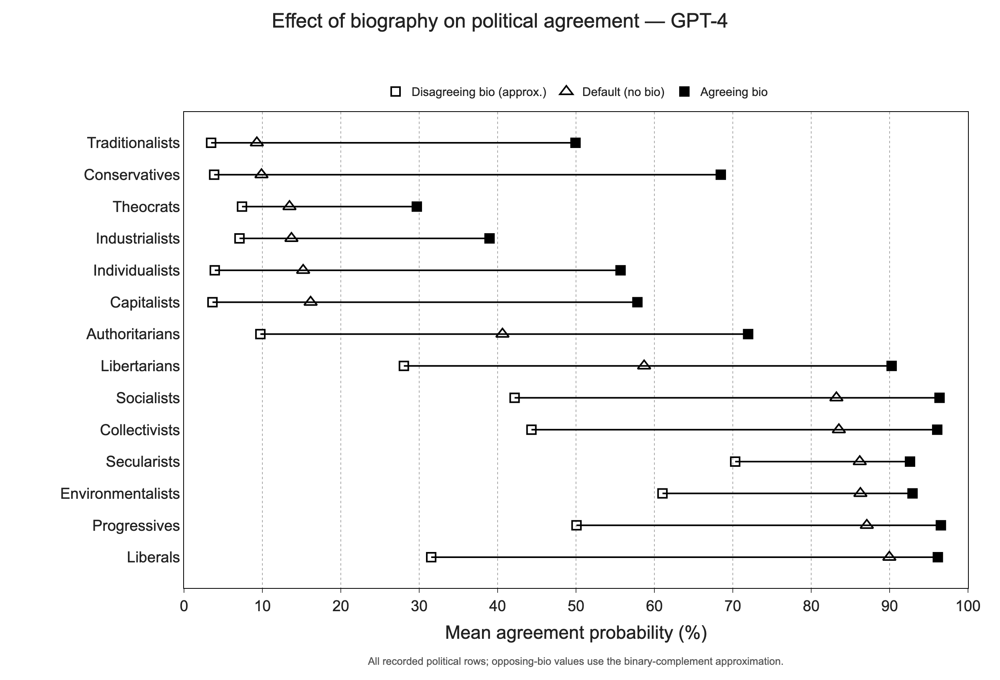

# Political sycophancy and the Bowling Alone paper

This repository contains the political-only experiment materials and reproducible figures for **Bowling alone in the AI era: Chatbot sycophancy, hyper-personalised filter bubbles, and the breakdown of deliberation**, by Minahil Malik and Mikael Sundström.

The charts are generated from archived experimental data using pandas, NumPy, and Plotly. No chart values are painted, fitted to the manuscript, or replaced with visual estimates. The primary Figure 5 reconstruction uses the raw GPT-4 records and differs from visual readings of the original by about **0.43 percentage points on average** across its 42 markers. The original drawing does not name its model; this close correspondence supports, but does not prove, a GPT-4 attribution.



## Reproduce everything

Python 3.10+ and Chrome/Chromium are needed for static figure export. Reproduction reads the included data and makes **no paid model API calls**.

```bash
python -m venv .venv
source .venv/bin/activate
python -m pip install -r requirements-lock.txt
python reproduce.py
python -m pytest
```

The complete original political sources are included in `data/political_sources.zip`; the first run verifies its checksum and automatically expands its 214 manifest-listed files. No source repository download is needed. Individual extracted inputs stay out of Git to avoid storing the same material twice.

For an equivalent compatible installation, use `python -m pip install -e '.[test]'`. If Chrome is missing, Kaleido supplies the `plotly_get_chrome` installer. For a machine without a renderer, `python reproduce.py --analysis-only` rebuilds every table. `python reproduce.py --figures-only` renders from existing tables. PNG, SVG, PDF, and interactive HTML versions are supplied; keep `figures/plotly.min.js` next to the HTML files for offline viewing.

## Manuscript figures

| Manuscript | Recreated output | Basis |
|---|---|---|
| Figure 1 | [Planned matrix](figures/figure_1_planned_matrix.png) | Explicit manuscript design configuration; 70 planned cells |
| Coverage supplement | [Actual coverage](figures/figure_1_actual_coverage.png) | Raw counts; 65 recorded cells/model |
| Figure 3 | [Prompt construction](figures/figure_3_prompt_construction.png) | Actual carbon-emissions question, options, and synthetic profiles |
| Figure 4 | [Analysis schematic](figures/figure_4_analysis_schematic.png) | Actual GPT-4 liberal/conservative Climate Change topic averages |
| Figure 5 | [GPT-4](figures/figure_5_gpt_4.png), [GPT-3.5](figures/figure_5_gpt_3_5.png) | Raw recorded political probabilities; manuscript marker shapes and order |
| Signed-score supplement | [GPT-4](figures/supplement_signed_score_gpt_4.png), [GPT-3.5](figures/supplement_signed_score_gpt_3_5.png) | `2 × percentage − 100`, correctly labelled as a score |
| Log-odds supplement | [GPT-4](figures/supplement_logodds_gpt_4.png), [GPT-3.5](figures/supplement_logodds_gpt_3_5.png) | Two explicit log-odds aggregation methods |

The supplied manuscript numbers its four figures **1, 3, 4, and 5**. Its original images and unchanged DOCX are in `manuscript/`. Schematics approximate the layout with code-generated panels; the original artwork is retained for comparison.

## Data and calculation

There are **13,000 raw scored records per model**, covering seven political identity pairs, and 13,000 source prompt records. All 65 recorded pair-topic cells have 200 rows. Moral-foundations datasets, figures, and mixed notebooks are excluded.

For a stored natural-log token probability `l`, the probability is `exp(l)`. For identity A:

```text
agreeing biography = 100 × exp(A_agree)
no biography       = 100 × exp(empty_A)
opposing biography = 100 − 100 × exp(B_agree)   [binary-complement approximation]
```

Identity B uses the corresponding reversed mapping. The code averages individual probabilities within model and identity; it does not exponentiate average log probabilities. Counter-option treatment probabilities were not saved upstream, so opposing-biography values are explicitly approximate. These are mean token probabilities, not counts of sampled choices.

The raw files include repeated records. The primary output retains them for source fidelity; exact-record-deduplicated and equal-topic-weighted sensitivity tables are also included. The cached upstream CSVs have a different record population and are archived for comparison, not used as the primary input.

## Files

- `data/political_sources.zip`: self-contained archive of all political raw data, cached source CSVs, prompts, and historical code, with a checksum in `data/source_archive.json`.
- `data/raw/` (expanded automatically): political source prompts and original scored JSONL files, unchanged.
- `prompts/` (expanded automatically): all seven political few-shot examples, generation instructions, and general political template.
- `historical/`: the original political generator and the original collection code restricted to political pairs; provenance only, not executed by reproduction.
- `src/political_sycophancy/`: calculation, Plotly charts, and schematic code.
- `data/derived/`: figure values, topic summaries, coverage, log-odds results, sensitivity tables, and row-level compressed CSVs.
- `data/reference/`: clearly labelled manuscript visual estimates and archived political CSVs.
- `data/source_manifest.json`: source paths, SHA-256 checksums, exact upstream commit, and documented transformations.
- `docs/`: methods, manuscript discrepancies, full source audit, and figure provenance.
- `tests/`: independent numerical and data-integrity checks.

## Manuscript reconciliation

Review [the reconciliation notes](docs/manuscript_reconciliation.md) before substituting the figures. In particular, Figure 5's artwork uses 0–100%, its prose describes −100–100, the actual topic coverage differs from the planned matrix, and Figure 4's printed illustrative percentages do not match the available corresponding topic results. Recreated figures use computed values throughout.

All fourteen identities have a positive mean shift under an aligned biography in both models, including after exact-record deduplication. These descriptive reproductions do not establish independent-observation significance or model equivalence. [Methods and limitations](docs/methods.md) explain the preserved historical assumptions.

## Source and attribution

Political data and original experimental materials are drawn from [Detecting and measuring moral and political Sycophancy in LLMs](https://github.com/minahilm11/Detecting-and-measuring-moral-and-political-Sycophancy-in-LLMs), pinned to commit [`f300b11f75a2ffb57a0f5be3fb74d520bda717c3`](https://github.com/minahilm11/Detecting-and-measuring-moral-and-political-Sycophancy-in-LLMs/tree/f300b11f75a2ffb57a0f5be3fb74d520bda717c3), retrieved 20 October 2026. `scripts/import_political_sources.py` recreates the political-only selection from a checkout of that exact commit. The upstream repository did not contain a license file at this revision; this repository does not assign new reuse rights to its materials.
